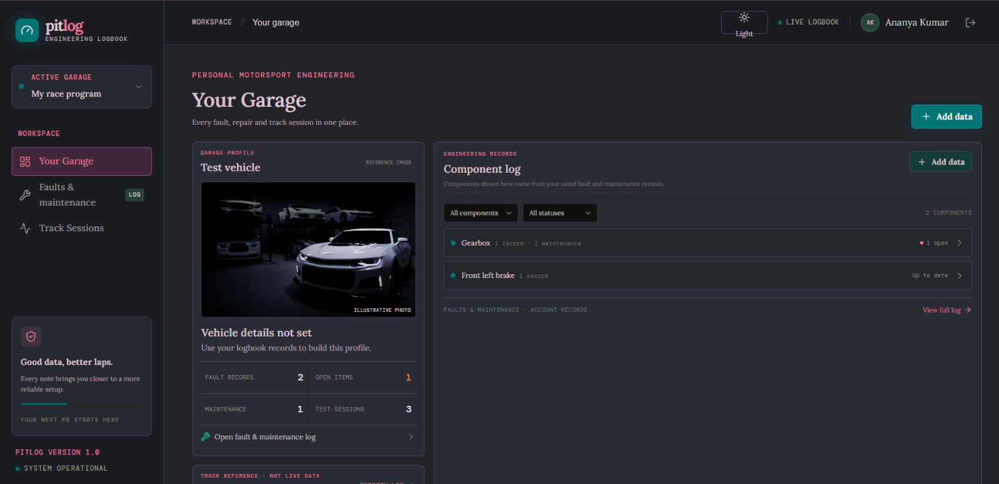

# PitLog — Motorsport Engineering Logbook

## Demo



## Problem statement

Student racing and karting drivers often keep faults, maintenance, setup changes, and test observations in scattered notebooks or chats. That makes it hard to connect a repair or setup decision with what the car did on track.

PitLog gives an individual driver one private, persistent engineering history. The target user is a student racer or karting enthusiast who wants to record car issues, track repairs, and learn from each test session. Better organized records can help the driver spot recurring problems and make informed setup decisions; PitLog is a logbook, not a substitute for qualified mechanical inspection or safety checks.

## Core features

- **Authentication:** sign up and sign in with email/password; API hashes passwords and protects routes with signed tokens.
- **Engineering dashboard:** a garage-style vehicle profile, real fault/maintenance counts, a selectable track-map reference for recent sessions, and a component list built only from saved records.
- **Fault and maintenance log:** create, read, edit, delete, search, severity/status filter, and cycle status.
- **Testing logbook:** record date, track, session type, conditions, setup changes, and observations; edit/delete entries and search notes.
- **Private persistence:** the API scopes each query and write to the authenticated user in MongoDB Atlas.
- **Responsive interface:** designed for desktop and mobile, with loading, empty, confirmation, and error states.
- **Motorsport motion detail:** original car silhouettes pass through the sign-in illustration background; the decorative animation is disabled when reduced motion is requested.
- **Session-linked circuit map:** select a recent test session to show its track-specific map and route animation for Yas Marina, Silverstone, or Spa-Francorchamps. Unsupported venues stay selected and clearly show that no verified map is available; no other track is substituted. Map animations are visual references, not live timing data.
- **Illustrative vehicle image:** `public/garage-car.jpg` is a performance-car photo served by Unsplash. It is decorative only and does not represent a vehicle stored in the user's profile.

## Tech stack

- React 18, Vite, React Router
- Express API and official MongoDB Node.js driver connected to MongoDB Atlas
- bcryptjs password hashing, JSON Web Tokens, dotenv
- CSS design system and Lucide icons

Atlas is the requested database. Express provides the authentication and API layer, while Atlas persists user and logbook records. The Atlas URI and token-signing secret are server-only environment variables.

## React concepts demonstrated

| Requirement | Where to explore |
|---|---|
| Functional components, props, composition | `src/App.jsx`, `src/components/Brand.jsx`, `src/pages/AuthPage.jsx` |
| `useState`, conditional rendering, lists and keys | Modal forms, empty/loading states, and record/session lists in `src/App.jsx` and `src/pages/AuthPage.jsx` |
| Side effects (`useEffect`) | Session restore in `src/context/AuthContext.jsx`, record loading in `src/context/LogbookContext.jsx` |
| Controlled components | Login/signup, fault, session, search, and filter forms |
| Lifting state up | `LogbookProvider` owns shared fault/session state for the dashboard and logbook routes |
| React Router and protected routes | Route definitions and `ProtectedRoute` in `src/App.jsx` |
| Context API | `AuthProvider` and `LogbookProvider` in `src/context/` |
| `useMemo` | Dashboard metrics and filtered/sorted logbook entries in `src/App.jsx` |
| `useCallback` | Auth and API operations in `src/context/` |
| `useRef` | `src/hooks/useSearchShortcut.js` focuses the active search field with Ctrl/Cmd+K |
| `React.lazy` and `Suspense` | Sign-in/sign-up route chunk in `src/App.jsx` and `src/pages/AuthPage.jsx` |

These are used to solve real UI/state problems rather than added as unused examples. For the viva, be ready to explain how a controlled form submits to the API, how context shares records across routes, why records are scoped by the server, and what the search shortcut's ref points to.

## Circuit map attribution

Circuit maps and route geometry are local, track-specific Wikimedia Commons assets:

- `public/yas-marina-layout.png`: 2021-present Yas Marina Circuit layout by Anthony Alessio Tralongo, [CC BY-SA 4.0](https://creativecommons.org/licenses/by-sa/4.0/), [source](https://commons.wikimedia.org/wiki/File:Yas_Marina_Circuit.png). The animated route follows the highlighted segment in the map.
- `public/silverstone-circuit.svg`: Silverstone Grand Prix layout, [CC0](https://creativecommons.org/public-domain/cc0/), [source](https://commons.wikimedia.org/wiki/File:Circuit_Silverstone_2011.svg).
- `public/spa-circuit.svg`: Spa-Francorchamps map by Will Pittenger, [CC BY-SA 3.0](https://creativecommons.org/licenses/by-sa/3.0/), [source](https://commons.wikimedia.org/wiki/File:Spa-Francorchamps_of_Belgium.svg).

The Silverstone and Spa animated routes use the circuit path embedded in their respective map SVGs. Marker motion is illustrative; it does not represent live vehicle telemetry or timing.

## Project structure

```text
src/
  components/       Shared UI components
  context/          Authentication and logbook state providers
  hooks/            Reusable hooks
  pages/            Route-level pages (auth is lazy-loaded)
  services/         Browser-to-API service
  App.jsx           Route composition and dashboard/logbook screens
  main.jsx          React entry point and provider composition
server/
  index.js          Express routes, auth, validation, Atlas connection
```

## Run locally

### Requirements

- Node.js 20.19+ or 22.12+
- MongoDB Atlas cluster

### Configure Atlas

1. In Atlas, create a database user with read/write access to the `pitlog` database.
2. Add your development IP address to the Atlas project's Network Access IP access list.
3. Copy the environment template:

   ```powershell
   Copy-Item .env.example .env
   ```

4. Put the current Atlas **Drivers** connection string in `MONGODB_URI` in `.env`. URL-encode special characters in the database username/password.
5. Generate a strong JWT secret:

   ```powershell
   node -e "console.log(require('node:crypto').randomBytes(32).toString('hex'))"
   ```

   Put it in `JWT_SECRET`. Do not use the example placeholder. Never commit or share `.env`; it is ignored by Git.

### Install and start

```powershell
npm install
npm run dev:full
```

Open `http://localhost:5173` and create an account. Vite proxies `/api` requests to Express on port `3001`. The API connects to Atlas at startup; connection or IP/DNS errors appear in the terminal. Do not put database credentials in frontend variables.

## Deploy to Vercel and Render

Deploy the Vite frontend to Vercel and the Express API to Render as separate services. Configure these environment variables:

| Service | Variable | Value |
|---|---|---|
| Vercel | `VITE_API_BASE_URL` | The Render API origin, such as `https://your-service.onrender.com` (no trailing slash or `/api`) |
| Render | `MONGODB_URI` | Your Atlas connection string |
| Render | `MONGODB_DB` | `pitlog` |
| Render | `JWT_SECRET` | A strong, private random secret of at least 32 characters |
| Render | `CLIENT_URL` | The exact deployed Vercel origin, such as `https://your-project.vercel.app` |

Set the Vercel variable for the Production environment and redeploy so it is included in the frontend build. The Render API service should use `npm install` as its build command and `npm run server` as its start command. Confirm `https://your-service.onrender.com/api/health` returns `{"status":"ok"}`. Do not set Atlas credentials or `JWT_SECRET` in Vercel or in any `VITE_` variable.

## API routes

- `POST /api/auth/signup`, `POST /api/auth/login`, `GET /api/auth/me`
- `GET|POST /api/faults`, `PATCH|DELETE /api/faults/:id`
- `GET|POST /api/sessions`, `PATCH|DELETE /api/sessions/:id`

All fault/session routes require a bearer token. Server-side validation enforces allowed status, severity, type, and field limits.

## Validation and demo checklist

Run checks:

```powershell
npm run lint
npm run build
```

Before recording the 3–5 minute demo, configure Atlas and verify this complete flow: sign up → create a fault → edit it → mark it resolved → refresh and confirm it persists → add a test session → show dashboard metrics → delete a record. Explain the problem/user first, then the feature flow, architecture, and React concepts. Demonstrate using your own configured account; never show `.env` or its secrets.

## Connection management

The API reuses one `MongoClient` for its lifetime and keeps driver pool/timeouts at their defaults rather than guessing workload-specific values. If deployed or experiencing queueing, inspect Atlas connection and latency metrics before tuning.
